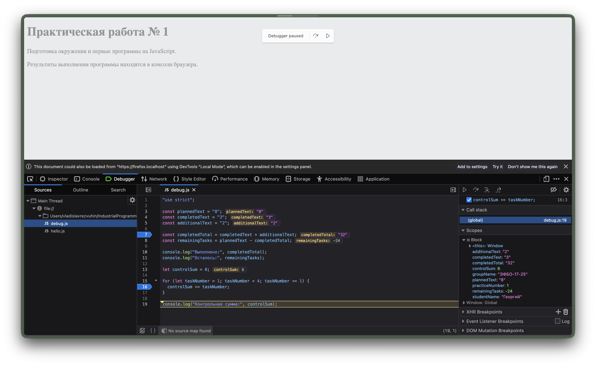

# Практическая работа № 1. Подготовка окружения и первые программы на JavaScript

## 1. Автор и вариант

- Автор: Резвухин Георгий
- Группа: ЭФБО-17-25
- Вариант: 5 (`totalTasks = 7`, `completedTasks = 2`, `dailyLimit = 2` — для проверки общих правил во всех заданиях использовался также сквозной пример `totalTasks = 12`, `completedTasks = 5`, `dailyLimit = 3`)

## 2. Окружение

- ОС: macOS Golden Gate 27
- Node.js: v24.14.1
- npm: 11.11.0
- Git: git version 2.54.0 (Apple Git-157)
- Браузер: Zen

## 3. Запуск

Все команды выполняются из корня репозитория:

```bash
node practice-01/js/hello.js
node practice-01/js/types.js
node practice-01/js/progress.js
node practice-01/js/plan.js
node practice-01/js/debug.js
```

Для браузера: открыть `practice-01/index.html`, заменить путь в `<script>` на нужный файл (`./js/hello.js`, `./js/types.js`, `./js/progress.js`, `./js/plan.js`, `./js/debug.js`), сохранить изменения, перезагрузить страницу и посмотреть вкладку Console в DevTools.

Все пять обязательных файлов дают в браузере те же результаты, что и в Node.js. Единственное отличие ожидаемо и разобрано в задании 1: `typeof document` в браузере возвращает `"object"`, а в Node.js — `"undefined"`.

**Перед сдачей проверить:** в `index.html` должно быть возвращено подключение `./js/hello.js` (на момент подготовки скриншотов в разделе «Запуск» там ещё был подключён `debug.js`, использовавшийся для последней проверки). В `progress.js` и `plan.js` данные варианта уже выставлены и проверены (`totalTasks=7, completedTasks=2`, для `plan.js` дополнительно `dailyLimit=2`).

## 4. Задание 1: различие результатов в двух средах

Файл `practice-01/js/hello.js` запускался и через `node practice-01/js/hello.js`, и в браузере (через `practice-01/index.html`, вкладка Console). Первые четыре строки вывода в обеих средах одинаковы (данные о студенте, группе и практической работе). Различается только последняя строка:

| Среда | Где появился вывод | Последняя строка |
|---|---|---|
| Node.js (терминал) | В терминале, в окне командной строки | `Тип document: undefined` |
| Браузер (Zen) | Только во вкладке Console DevTools; на самой странице вывода нет | `Тип document: object` |

Причина различия: `document` — объект, который предоставляет браузер (модель DOM, представление загруженной HTML-страницы). В Node.js ни страницы, ни DOM нет, поэтому глобальной переменной `document` там не существует. Оператор `typeof` не выбрасывает исключение даже для необъявленного идентификатора (в том числе в строгом режиме), а возвращает строку `"undefined"`. В браузере `document` существует и является объектом, поэтому `typeof document` даёт `"object"`.

## 5. Задание 2: таблица предсказаний, результатов, типов и объяснений

Для каждого из десяти выражений из `practice-01/js/types.js` сначала было записано ожидаемое значение и тип, затем результат проверен через `console.log()` — и в Node.js, и в браузере (результаты совпали).

| Выражение | Ожидание до запуска | Фактическое значение | Тип результата | Объяснение |
|---|---|---|---|---|
| `"8" + 2` | `"82"`, string | `"82"` | string | Если один из операндов строка, `+` выполняет конкатенацию: число `2` приводится к строке `"2"` и присоединяется к `"8"`. |
| `"8" - 2` | `6`, number | `6` | number | Оператор `-` определён только для чисел, поэтому строка `"8"` неявно приводится к числу `8`; результат `8 - 2 = 6`. |
| `Number("8") + 2` | `10`, number | `10` | number | `Number("8")` явно преобразует строку в число `8`; оба операнда числа, `+` складывает их. |
| `"12" > "3"` | `false`, boolean | `false` | boolean | Обе стороны строки, сравнение лексикографическое, посимвольно: `"1"` (код 49) меньше `"3"` (код 51), значит `"12" < "3"`. Числового сравнения не происходит. |
| `12 === "12"` | `false`, boolean | `false` | boolean | Строгое равенство `===` не приводит типы: `number` и `string` — разные типы, результат `false`. (Нестрогое `12 == "12"` дало бы `true`.) |
| `Number("")` | `0`, number | `0` | number | Пустая строка (как и строка из одних пробелов) по правилам преобразования в число даёт `0`, а не `NaN`. |
| `Number("text")` | `NaN`, number | `NaN` | number | Строку `"text"` нельзя разобрать как число, поэтому результат `NaN`; тип у `NaN` при этом всё равно `number`. |
| `Boolean("false")` | `false`, boolean | `true` | boolean | При логическом преобразовании ложны только `""`, `0`, `NaN`, `null`, `undefined`, `false` и `0n`. Любая непустая строка, в том числе `"false"`, даёт `true`. |
| `typeof null` | `"null"`, string | `"object"` | string | Значение выражения — строка `"object"` (историческая особенность языка: `null` не является объектом, но `typeof null` возвращает `"object"`). Тип самого результата — `string`, потому что `typeof` всегда возвращает строку. |
| `typeof NaN` | `"number"`, string | `"number"` | string | Значение выражения — строка `"number"`: `NaN` — специальное значение типа `number` (IEEE 754). Тип результата — `string`, так как `typeof` возвращает строку. |

## 6. Задания 3 и 4: таблицы проверок

### Задание 3 — `practice-01/js/progress.js`

Проверки выполнены командой `node practice-01/js/progress.js` со сменой `totalTasks`/`completedTasks` перед каждым запуском.

| Проверка | Входные данные | Ожидаемый результат | Фактический результат | Итог |
|---|---|---|---|---|
| Обычный случай | `totalTasks=12, completedTasks=5` | Осталось 7; прогресс 41.7%; статус «В работе» | `Осталось задач: 7`, `Прогресс выполнения: 41.67%`, `Статус: В работе` | Пройдено |
| Оба нуля | `totalTasks=0, completedTasks=0` | «Задач пока нет», без расчёта процента | `Задач пока нет`, далее `Осталось задач: 0`, `Прогресс выполнения: 0.00%`, `Статус: Не начато` | Пройдено |
| Ничего не выполнено | `totalTasks=5, completedTasks=0` | Осталось 5; прогресс 0.0%; статус «Не начато» | `Задач пока нет`, `Осталось задач: 5`, `Прогресс выполнения: 0.00%`, `Статус: Не начато` (сообщение «Задач пока нет» печатается при `completedTasks === 0` независимо от `totalTasks`) | Пройдено |
| Всё выполнено | `totalTasks=5, completedTasks=5` | Осталось 0; прогресс 100.0%; статус «Завершено» | `Осталось задач: 0`, `Прогресс выполнения: 100.00%`, `Статус: Завершено` | Пройдено |
| Граничный случай | `totalTasks=5, completedTasks=6` | Ошибка: выполнено больше, чем существует | `Ошибка: выполнено больше, чем существует.` | Пройдено |
| Некорректные данные | `totalTasks=-1, completedTasks=0` | Ошибка: отрицательное количество | `Ошибка: отрицательное количество.` | Пройдено |
| Некорректные данные | `totalTasks=5, completedTasks=2.5` | Ошибка: дробное количество | `Ошибка: дробное количество.` | Пройдено |
| Некорректные данные | `totalTasks="5", completedTasks=2` | Ошибка: вместо числа передана строка | `Ошибка: вместо числа передана строка.` | Пройдено |
| Некорректные данные | `totalTasks=1001, completedTasks=0` | Ошибка: превышена верхняя граница | `Ошибка: превышена верхняя граница.` | Пройдено |
| Некорректные данные | `totalTasks=NaN, completedTasks=0` | Ошибка: недопустимое числовое значение | `Ошибка: недопустимое числовое значение.` | Пройдено |
| Свой вариант | `totalTasks=7, completedTasks=2` | Осталось 5; прогресс 28.6%; статус «В работе» | `Осталось задач: 5`, `Прогресс выполнения: 28.57%`, `Статус: В работе` | Пройдено |

### Задание 4 — `practice-01/js/plan.js`

Проверки выполнены командой `node practice-01/js/plan.js` со сменой `totalTasks`/`completedTasks`/`dailyLimit` перед каждым запуском; иллюстрации сохранены в основном Word-отчёте (рисунки 13–22).

| Проверка | Входные данные | Ожидаемый результат | Фактический результат | Итог |
|---|---|---|---|---|
| Обычный случай | `totalTasks=12, completedTasks=5, dailyLimit=3` | 3 дня; в последний день выполнена 1 задача | `День 1: выполнено 3, осталось 4`, `День 2: выполнено 3, осталось 1`, `День 3: выполнено 1, осталось 0`, `Потребуется дней: 3` | Пройдено |
| Ровное деление | `totalTasks=10, completedTasks=4, dailyLimit=3` | 2 дня, по 3 задачи в день | `День 1: выполнено 3, осталось 3`, `День 2: выполнено 3, осталось 0`, `Потребуется дней: 2` | Пройдено |
| Норма больше остатка | `totalTasks=5, completedTasks=3, dailyLimit=10` | 1 день, выполнены обе оставшиеся задачи | `День 1: выполнено 2, осталось 0`, `Потребуется дней: 1` | Пройдено |
| Всё уже выполнено | `totalTasks=5, completedTasks=5, dailyLimit=2` | 0 дней; цикл не выполняется | `Потребуется дней: 0`, цикл не запускался | Пройдено |
| Оба нуля | `totalTasks=0, completedTasks=0, dailyLimit=2` | 0 дней; цикл не выполняется | `Потребуется дней: 0`, цикл не запускался | Пройдено |
| Недопустимая норма | `totalTasks=5, completedTasks=2, dailyLimit=0` | Ошибка; цикл не запускается | Ошибка, цикл не запускался (см. рисунок 18 в отчёте) | Пройдено |
| Дробная норма | `totalTasks=5, completedTasks=2, dailyLimit=1.5` | Ошибка: дробной нормы быть не должно | Ошибка, цикл не запускался (см. рисунок 19 в отчёте) | Пройдено |
| Граничный случай | `totalTasks=5, completedTasks=6, dailyLimit=2` | Ошибка: некорректное число выполненных задач | `Ошибка: некорректное число выполненных задач.` | Пройдено |
| Норма строкой | `totalTasks=5, completedTasks=2, dailyLimit="2"` | Ошибка: норма задана строкой | `Ошибка: вместо числа передана строка.` | Пройдено |
| Верхняя граница нормы | `totalTasks=5, completedTasks=2, dailyLimit=1001` | Ошибка: превышена верхняя граница нормы | `Ошибка: цикл не запускается.` | Пройдено |
| Свой вариант | `totalTasks=7, completedTasks=2, dailyLimit=2` | 3 дня (2+2+1) | `Осталось задач: 5`, `День 1: выполнено 2, осталось 3`, `День 2: выполнено 2, осталось 1`, `День 3: выполнено 1, осталось 0`, `Потребуется дней: 3` | Пройдено |

## 7. Отладка

В файле `practice-01/js/debug.js` были две намеренные ошибки. Исходный вариант запущен без изменений (`node practice-01/js/debug.js`) и дал:

```text
Выполнено: 32
Осталось: -24
Контрольная сумма: 6
```

Обе строки некорректны ещё до анализа кода в отладчике.

**Причины ошибок**, найденные через точки останова, Step over и панель Scope в DevTools:

1. **Обработка количества задач.** `completedTotal = completedText + additionalText` складывал строки `"3"` и `"2"` через конкатенацию (`+`), а не через сложение чисел, поэтому `completedTotal` становился строкой `"32"`, а `remainingTasks` — числом `-24`. Исправление: `completedTotal = Number(completedText) + Number(additionalText)` (и аналогично `Number(plannedText)` для `remainingTasks`).
2. **Граница цикла.** Цикл был объявлен как `for (let taskNumber = 1; taskNumber < 4; taskNumber += 1)` — с фиксированным числом `4`, не связанным с данными задачи, и со строгим `<`, из-за чего последнее значение (4) не попадало в сумму. Исправление: `taskNumber <= 4`.

Иллюстрация точки останова (отладчик остановлен на строке 19, видно исследуемые значения `completedTotal`, `remainingTasks` и `controlSum` в панели Scope):



После исправления обеих ошибок программа повторно запущена и в браузере, и в Node.js:

```text
Выполнено: 5
Осталось: 3
Контрольная сумма: 10
```

Результат совпадает с ожидаемым по условию задания. Активные точки останова после отладки сняты.

## 8. Вывод

Практическая работа закрепила разницу между средами выполнения JavaScript (Node.js и браузер: одинаковый язык, но разный набор глобальных объектов — `document` есть только в браузере), правила неявного и явного приведения типов (конкатенация `+` для строк, `Number()`, `typeof`, поведение `NaN`), написание защитных проверок входных данных без хардкода результатов и работу с отладчиком DevTools (точки останова, Step over, панель Scope).

Самой показательной оказалась ошибка с границей цикла в задании 5: она не выбрасывала исключение и на первый взгляд программа «работала», но верхняя граница цикла была задана произвольным числом, не связанным с реальными данными задачи, — а не отсутствием проверок типов. Это ясно показало, что отсутствие ошибки в консоли ещё не значит, что результат правильный, и что перед тем, как доверять выводу программы, его нужно реально проверить, а не полагаться на то, что код «выглядит рабочим».

**Дополнительное задание — вариант Б.** В отдельном файле `practice-01/js/plan-week.js` построено расписание выполнения оставшихся задач по календарным дням: первый день — понедельник, суббота и воскресенье — выходные, дневная норма действует только в рабочие дни, а лишние выходные после завершения последней задачи в расписание не добавляются. Контрольный случай (`totalTasks=6, completedTasks=0, dailyLimit=1`) дал ожидаемые 6 рабочих и 8 календарных дней. Дополнительно проверены: отсутствие оставшихся задач (оба счётчика — 0), закрытие остатка за один день, укладка ровно в рабочую неделю без выходных, расписание с двумя выходными подряд и защита от недопустимой (нулевой) дневной нормы, исключающая бесконечный цикл. Все проверки прошли (подробности и полный вывод — в основном Word-отчёте, раздел «Дополнительное задание»).