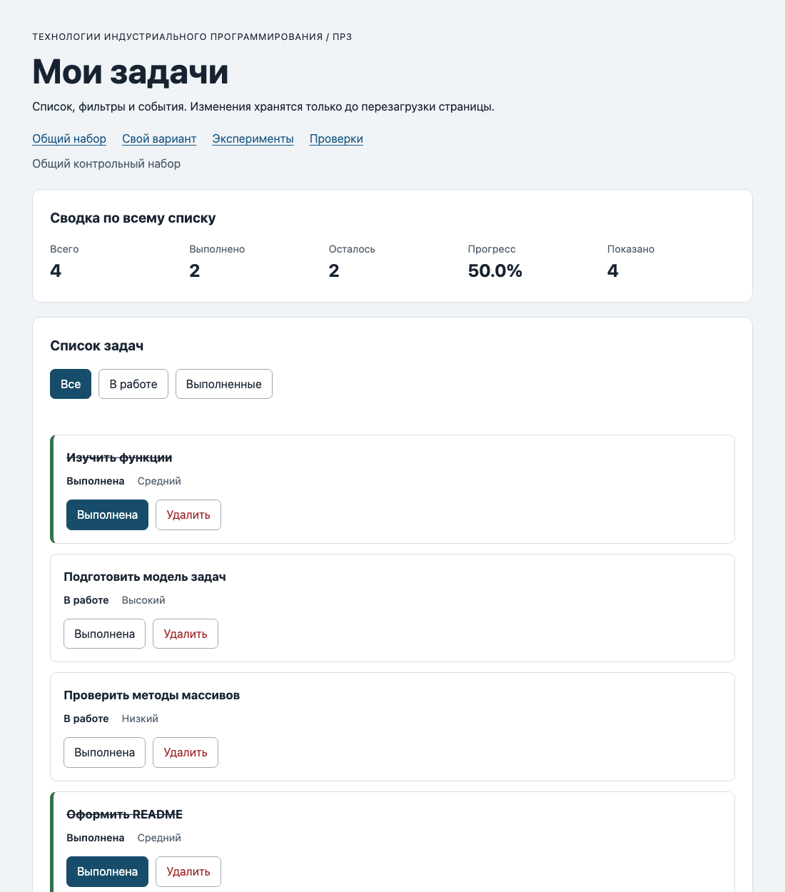

# Практическая работа № 3. Работа с DOM и событиями

## Данные работы

| Поле | Значение |
|---|---|
| Имя | Резвухин Георгий Владиславович |
| Группа | ЭФБО-17-25 |
| Вариант из ПР2 | 5 — «Разработка командного прототипа» |
| Node.js | v24.14.1 (npm 11.11.0) |
| Браузер | Google Chrome 154.0.8037.98 (Chromium) |
| Операционная система | macOS 27.0.1 |

## Запуск

Рабочая папка: `practice-03` внутри личного репозитория `tip-js-practices`.

```bash
npm run check:service
npm start
```

Устанавливать зависимости через `npm install` не требуется. Сервер запускается на стандартном порту `5503`.

```text
http://127.0.0.1:5503/
http://127.0.0.1:5503/index.html?dataset=variant
http://127.0.0.1:5503/examples/dom-events.html
http://127.0.0.1:5503/checks.html
```

Остановка сервера: `Ctrl+C`. Если порт занят, используется другой: `node tools/serve.mjs 5504`, и во всех адресах подставляется `5504`.

## Что перенесено из ПР2

`src/task-service.js` и `src/data.js` скопированы из `practice-02/src` без изменений. В `data.js` заполнены `demoTasks` (id `[1, 4, 7, 10]`), `variantNumber = 5` и шесть задач варианта с id `[11, 23, 37, 41, 58, 64]`. Повторная проверка `npm run check:service` — 35 из 35, исправлений в логике ПР2 не потребовалось. `task-service.js` не обращается к `document`.

## Эксперименты

Страница `examples/dom-events.html`. Прогноз записан до нажатий, результат — из Console и журнала на странице.

| № | До запуска: прогноз | После запуска: результат | Объяснение |
|---:|---|---|---|
| 1. Отсутствующий элемент и коллекция | `querySelector` вернёт `null`, `querySelectorAll` — пустую коллекцию длины 0; обращение к свойству `null` вызовет ошибку. | `Отсутствующий элемент: null`, `Пустая коллекция: 0`. Запись `document.querySelector('#absent').textContent = 'x'` даёт `TypeError: Cannot set properties of null`. | Поиск без совпадений не бросает ошибку, а возвращает `null` или пустой `NodeList`. Ошибка возникает при обращении к свойству `null`, поэтому результат поиска нужно проверять. |
| 2. dataset и числовой id | `dataset.taskId` — строка `"23"`, после `Number` — число `23`. | `dataset.taskId: 23 string`, `Числовой id: 23`. | Все значения `data-*` хранятся как строки. В модель ПР2 нужно передавать число, иначе `task.id === id` не найдёт запись. |
| 3. Статический NodeList | Старая коллекция останется длины 1, новый запрос будет увеличиваться. | После 1-го нажатия: `Старый NodeList: 1`, `Новый querySelectorAll: 2`; после 2-го: `1` и `3`. | `querySelectorAll` возвращает снимок на момент вызова. Новые `li` в него не попадают — нужен повторный запрос. |
| 4. Строка с HTML-разметкой | В заголовке появится строка с угловыми скобками, элемента `strong` не будет. | Текст заголовка: `<strong>Это текст, а не HTML</strong>`, у `#lab-title` нет дочерних элементов. | `textContent` записывает текст, а не разбирает HTML. Название задачи не может превратиться в разметку. |
| 5. Распространение события | Сначала захват на `lab-card`, затем обработчик кнопки, затем всплытие на `lab-card`; `target` везде `span`. | `1. phase=1; target=lab-label; currentTarget=lab-card`<br>`2. phase=3; target=lab-label; currentTarget=lab-button`<br>`3. phase=3; target=lab-label; currentTarget=lab-card` | `target` — элемент, по которому нажали (`span`), он не меняется. `currentTarget` — элемент, чей обработчик выполняется сейчас. Кнопка получила событие в фазе 3, потому что цель — вложенный `span`, а кнопка — его предок. |

**Почему обработчик контейнера получает нажатие на вложенный элемент.** Событие `click` после цели всплывает по цепочке предков: `span → button → li → ul`. Поэтому один обработчик на `ul#task-list` получает нажатия по любым кнопкам в карточках, а `event.target.closest("button[data-action]")` находит кнопку, даже если нажали по её подписи. В точке останова в обработчике кнопки: `event.target` — `span#lab-label`, `event.currentTarget` — `button#lab-button`.

## Организация кода

| Файл | Что делает |
|---|---|
| `src/data.js` | Общий набор `demoTasks` и данные варианта. Только данные. |
| `src/task-service.js` | Функции ПР2: `findTaskById`, `getTaskStats`, `setTaskCompleted`, `removeTask` и др. Возвращают `{ ok: true, tasks }` или `{ ok: false, error }`, не меняют входной массив, не работают с DOM. |
| `src/task-selectors.js` | `getVisibleTasks(tasks, filter)`: для `pending` и `completed` — `filter`, для `all` — копия `tasks.slice()`. |
| `src/task-view.js` | `createTaskElement` создаёт карточку через `createElement` и `textContent`; `renderTaskList` очищает список через `replaceChildren()` и добавляет карточки циклом; `renderSummary` берёт `getTaskStats` и выводит `progress.toFixed(1) + "%"`; `renderEmptyState` различает «пуст» и «нет совпадений». Обработчиков событий здесь нет. |
| `src/main.js` | Текущее состояние, `renderApp` и обработчики нажатий. |

- **Полный список** хранится в `currentTasks`, **фильтр** — в `currentFilter` (`main.js`). Видимая выборка не сохраняется, а каждый раз вычисляется в `renderApp()`.
- **События** обрабатываются делегированно: `handleTaskListClick` на `ul#task-list` и `handleFilterClick` на `#task-filters`. `addEventListener` вызывается один раз в конце `main.js`, а не в `renderApp`.
- **Сводка** считается в `renderSummary` через `getTaskStats(currentTasks)` — по всему массиву; «Показано» = `visibleTasks.length`.

Путь одного действия: `click` по `span.action-label` → всплытие до `ul` → `closest("button[data-action]")` → проверка `toggle`/`delete` → `closest("li[data-task-id]")` → `Number(card.dataset.taskId)` и проверка `Number.isSafeInteger(id) && id > 0` → для `toggle` `findTaskById` и `setTaskCompleted(currentTasks, id, !task.completed)`, для `delete` `removeTask` → при `ok: false` сообщение в `#operation-message`, данные не меняются → при `ok: true` `currentTasks = result.tasks`, очистка сообщения, `renderApp()`, `restoreTaskFocus(id, action)`.

## Общий сценарий

Адрес `http://127.0.0.1:5503/index.html`, после перезагрузки. Действия выполнялись нажатием на вложенные подписи кнопок.

| Шаг | Видимые id | Всего | Выполнено | Осталось | Прогресс | Показано | Сообщение | Совпало с ожиданием |
|---:|---|---|---|---|---|---|---|---|
| 0 | `[1, 4, 7, 10]` | 4 | 2 | 2 | 50.0% | 4 | — | Да |
| 1 | `[4, 7]` | 4 | 2 | 2 | 50.0% | 2 | — | Да |
| 2 | `[7]` | 4 | 3 | 1 | 75.0% | 1 | — | Да |
| 3 | `[1, 4, 7, 10]` | 4 | 3 | 1 | 75.0% | 4 | — | Да |
| 4 | `[1, 4, 10]` | 3 | 3 | 0 | 100.0% | 3 | — | Да |
| 5 | `[]` | 3 | 3 | 0 | 100.0% | 0 | «Нет задач по выбранному фильтру.» | Да |
| 6 | `[1, 4, 10]` | 3 | 2 | 1 | 66.7% | 3 | — | Да |
| 7 | `[]` | 0 | 0 | 0 | 0.0% | 0 | «Список задач пуст.» | Да |

На всех шагах активным был выбранный фильтр (`is-active` и `aria-pressed="true"` только у одной кнопки), `#operation-message` оставался пустым.

После перезагрузки: снова шаг 0 — `[1, 4, 7, 10]`, 4 / 2 / 2 / 50.0%. Сохранения между загрузками в ПР3 нет, это ожидаемо.

После многократного переключения фильтров одно нажатие «Выполнена» у `id = 4` изменило ровно одну запись (3 выполнено, 75.0%) — обработчики не накапливаются.

## Индивидуальный вариант

Вариант 5, тема «Разработка командного прототипа». Адрес `index.html?dataset=variant`, метка на странице: «Индивидуальный вариант: 5».

| id | Название | Исходный статус | Приоритет |
|---:|---|---|---|
| 11 | Сформировать состав команды | Выполнена | Средний |
| 23 | Определить роли участников | Выполнена | Высокий |
| 37 | Подготовить техническое задание | Выполнена | Низкий |
| 41 | Настроить репозиторий проекта | Выполнена | Средний |
| 58 | Собрать черновой прототип | В работе | Высокий |
| 64 | Провести внутреннее тестирование | В работе | Низкий |

Исходно фильтр «В работе» показывал `[58, 64]`, «Выполненные» — `[11, 23, 37, 41]`.

| Этап | Всего | Выполнено | Осталось | Прогресс | Видимые id |
|---|---|---|---|---|---|
| До действий | 6 | 4 | 2 | 66.7% | `[11, 23, 37, 41, 58, 64]` |
| После переключения 23 | 6 | 3 | 3 | 50.0% | `[11, 23, 37, 41, 58, 64]` |
| После удаления 37 | 5 | 2 | 3 | 40.0% | `[11, 23, 41, 58, 64]` |
| Итог, фильтр «В работе» | 5 | 2 | 3 | 40.0% | `[23, 58, 64]` |
| Итог, фильтр «Выполненные» | 5 | 2 | 3 | 40.0% | `[11, 41]` |

Итог совпадает с таблицей методички для варианта 5 (выполнено 4 → 2, прогресс `40.0%`, остались `[11, 23, 41, 58, 64]`). Названия и приоритеты оставшихся задач не изменились.

## Протокол проверки сервиса

Фактический вывод `npm run check:service`:

```text
OK: 01. Создание задачи с явным приоритетом
OK: 02. Приоритет по умолчанию
OK: 03. Удаление краевых пробелов без изменения внутренних
OK: 04. Граничные длины названия и положительный безопасный id
OK: 05. Некорректные названия при создании
OK: 06. Некорректные идентификаторы при создании
OK: 07. Все допустимые приоритеты и отклонение недопустимых
OK: 08. Каждый вызов createTask возвращает новый объект
OK: 09. Поиск по id, а не по индексу
OK: 10. Отсутствующая задача и пустой массив при поиске
OK: 11. Поиск не преобразует строковый id в число
OK: 12. Получение невыполненных задач
OK: 13. Пустой список, все выполнены и все не выполнены
OK: 14. Названия в исходном порядке и пустой список
OK: 15. Сводка по общему набору
OK: 16. Сводка по пустому списку
OK: 17. Сводка: ничего не выполнено и выполнено всё
OK: 18. Процент остаётся числом без предварительного округления
OK: 19. Добавление в конец без изменения входного массива
OK: 20. Добавление в пустой список с приоритетом по умолчанию
OK: 21. Повторяющийся id отклоняется
OK: 22. Добавление не обходит проверки createTask
OK: 23. Изменение completed в обе стороны
OK: 24. completed принимает только boolean
OK: 25. Некорректный или отсутствующий id при изменении статуса
OK: 26. Повторная установка статуса создаёт новый результат
OK: 27. Переименование сохраняет остальные поля
OK: 28. Проверки названия при переименовании
OK: 29. Некорректный или отсутствующий id при переименовании
OK: 30. Удаление по id с сохранением порядка
OK: 31. Удаление единственной записи
OK: 32. Некорректный, отсутствующий id и удаление из пустого списка
OK: 33. Входные объекты не изменяются ни одной операцией
OK: 34. Общий сценарий и все промежуточные сводки
OK: 35. Работа с другим набором, без зависимости от demoTasks
Проверок пройдено: 35; не пройдено: 0.
```

## Протокол браузерных проверок

Текст из блока «Текстовый протокол» на `checks.html`:

```text
OK: Фильтр all возвращает новый массив в исходном порядке
OK: Фильтр pending выбирает невыполненные задачи
OK: Фильтр completed выбирает выполненные задачи
OK: Все три фильтра работают с пустым списком
OK: Фильтрация не меняет входные записи и их порядок
OK: Карточка — li.task-card с числовым id в dataset
OK: Статус невыполненной карточки и aria-pressed согласованы
OK: Статус выполненной карточки и aria-pressed согласованы
OK: В карточке две обычные кнопки с вложенными подписями
OK: Все приоритеты отображаются по установленному словарю
OK: Название с разметкой отображается текстом
OK: Отрисовка списка создаёт карточки в исходном порядке
OK: Повторная отрисовка не накапливает карточки
OK: Контейнер списка и его обработчик сохраняются
OK: Отрисовка пустого массива очищает прежние карточки
OK: Сводка считается по всему списку, отдельно выводится Показано
OK: Пустая сводка не содержит NaN и Infinity
OK: Сообщение для полностью пустого списка
OK: Сообщение для пустого результата фильтра
OK: Появление карточек скрывает прежнее пустое состояние
OK: Приложение: начальный набор и сводка
OK: Приложение: фильтр срабатывает по клику на вложенный span
OK: Приложение: активный фильтр отмечен классом и aria-pressed
OK: Приложение: фильтрация не удаляет скрытые задачи
OK: Приложение: переключение по id, а не индексу массива
OK: Приложение: выполненная задача исчезает из фильтра В работе
OK: Приложение: удаление изменяет данные, а не только DOM
OK: Приложение: клик по названию не изменяет данные
OK: Приложение: после перерисовок одно нажатие — одно изменение
OK: Приложение: удаление всех записей и нулевая сводка
OK: Приложение: нет совпадений — не то же самое, что нет задач
OK: Приложение: неизвестный числовой id не меняет данные
OK: Приложение: id 4abc не превращается в 4
OK: Приложение: неизвестное действие игнорируется
OK: Приложение: после изменения сохраняется клавиатурный фокус
OK: Приложение: новая загрузка возвращает исходное состояние

Всего: 36. Пройдено: 36. Ошибок: 0.
```

## Собственные проверки

| № | Исходное состояние и действия | Ожидаемый результат | Фактический результат | Итог |
|---:|---|---|---|---|
| 1 | **Граница.** `createTaskElement` для задачи с названием из 100 символов `"Я"`. | В `.task-title` ровно 100 символов, вложенных элементов нет. | Длина текста 100, дочерних элементов 0. | Пройдено |
| 2 | **Граница.** Одна выполненная задача `[{ id: 9, completed: true }]`, `getVisibleTasks` по трём фильтрам. | `all` и `completed` — 1 задача, `pending` — 0. | `all: 1`, `pending: 0`, `completed: 1`. | Пройдено |
| 3 | **Событие и перерисовка.** Общий набор, `id = 4` уже выполнена (`4/3/1/75.0%`); 5 быстрых нажатий подряд на «Выполнена» у `id = 7`. | Каждое нажатие — одно переключение; после 5 нажатий `id = 7` выполнена: `4/4/0/100.0%`. | `4/4/0/100.0%`, лишних срабатываний нет. | Пройдено |
| 4 | **Событие.** Клик по названию задачи `id = 4`. | `closest("button[data-action]")` вернёт `null`, данные не меняются. | Сводка осталась `4/2/2/50.0%`, сообщения нет. | Пройдено |
| 5 | **Данные.** Вариант 5: переключить 23, удалить 37, затем прочитать экспорт `variantTasks` из `data.js`. | Экспорт не изменён. | `[[11,true],[23,true],[37,true],[41,true],[58,false],[64,false]]` — без изменений, приложение работает с копией. | Пройдено |

## Отладка и клавиатура

**Точки останова:** `src/main.js:64` — `const id = Number(card.dataset.taskId);` в `handleTaskListClick`, и `src/main.js:87` — `currentTasks = result.tasks;`.

Нажатие на подпись «Выполнена» у задачи `id = 4` (общий набор, фильтр «Все»):

| Значение | Результат |
|---|---|
| `event.target` | `span.action-label` |
| `event.currentTarget` | `ul#task-list` |
| `card.dataset.taskId` | `"4"`, тип `string` |
| `id` | `4`, тип `number` |
| `action` | `"toggle"` |
| `findTaskById(currentTasks, 4)` | `{ id: 4, title: "Подготовить модель задач", completed: false, priority: "high" }` |
| `setTaskCompleted(currentTasks, 4, true)` | `{ ok: true, tasks: [...] }` — новый массив из 4 задач, у `id = 4` `completed: true`, остальные без изменений |

После `currentTasks = result.tasks` вызывается `renderApp()`: карточка `id = 4` создаётся заново со статусом «Выполнена» и `aria-pressed="true"`, сводка становится `4/3/1/75.0%`.

**Отказ по атрибуту карточки** (изменение `data-task-id` у карточки `id = 4` в панели Elements):

| Значение `data-task-id` | Действие | Сообщение | Данные |
|---|---|---|---|
| `777` | Удалить | «Задача с id = 777 не найдена» | Без изменений: `4/2/2/50.0%`. После нажатия «Все» карточки перерисованы из массива — `[1, 4, 7, 10]`, сообщение очищено. |
| `4abc` | Выполнена | «Некорректный идентификатор задачи: 4abc» | Без изменений: `4/2/2/50.0%`. `Number("4abc")` даёт `NaN`, поэтому строка не превращается в `4`. |

**Клавиатура.** `Tab` переходит по ссылкам, фильтрам и кнопкам карточек, фокус виден (оранжевая обводка). На кнопке «Выполнена» задачи `id = 1` клавиша `Space` сняла отметку (`aria-pressed="false"`), `Enter` вернула её (`aria-pressed="true"`). После перерисовки фокус остаётся на той же кнопке той же задачи (`restoreTaskFocus`). После удаления задачи `id = 10` фокус перешёл на активный фильтр «Все».

## Вид приложения

Общий набор после загрузки:



## Дополнительное задание

Дополнительное задание не выполнялось.

## Вывод

Список задач подключён к странице без переписывания бизнес-логики: данные меняют функции ПР2, а `main.js` только определяет действие, проверяет идентификатор и сохраняет успешный результат. Карточки создаются DOM-методами, названия выводятся через `textContent`. При перерисовке заменяется только содержимое `ul`, поэтому один делегированный обработчик продолжает работать и не дублируется. Пройдены 35 проверок сервиса и 36 браузерных проверок, общий сценарий и сценарий варианта 5 совпали с ожиданиями.

Главное различие: **изменение DOM** (удаление `li`, смена класса) меняет только отображение и пропадает при следующей отрисовке; **изменение данных** — это новый `currentTasks` от `removeTask` или `setTaskCompleted`, а DOM всегда строится заново из него. Фильтр меняет только `currentFilter`, поэтому скрытые задачи не теряются, а сводка считается по полному массиву.
